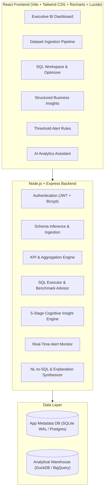

# 🚀 InsightFlow — AI-Powered Business Analytics & Intelligence Platform

> **Working Name**: InsightFlow  
> **Platform**: Business Intelligence, SQL Optimization, Analytical Warehousing & AI Analytics Assistant  
> **Version**: 1.0.0

---

## 📖 Product Overview

**InsightFlow** is an enterprise-grade business intelligence and analytics platform designed for business managers, business analysts, and data analysts. It allows users to:
1. **Upload & Ingest Datasets**: Upload CSV/JSON business records, infer schemas dynamically, and load data into the analytical warehouse pipeline.
2. **Execute Analytical SQL**: Write and execute analytical queries (CTEs, Window functions, Aggregations, GROUP BY, HAVING) with execution performance tracking.
3. **Query Optimization Advisor**: Receive real-time efficiency scoring and optimization tips (e.g., avoiding `SELECT *`, partition pruning for BigQuery).
4. **Interactive BI Dashboard**: Visualize core executive KPIs (Revenue, Profit, Orders, AOV, Profit Margin, MoM Growth) with dynamic multi-dimensional filters.
5. **Structured Business Insights**: Automatically generate insights structured as `Metric → Trend → Root Cause → Business Impact → Recommendation`.
6. **Rule-Based Alerts & Monitoring**: Configure threshold-based guardrails (e.g., `Profit Margin < 25%`, `Revenue Milestone > $50,000`) and track triggered alert logs.
7. **AI Analytics Assistant**: Converse with an AI data analyst that generates validated SQL queries, displays results in interactive charts, and provides clear business explanations.

---

## 🏛️ System Architecture & Data Flow



---

## ⚡ Quick Start

### 1. Prerequisites
- Node.js `v18+` or `v22+`
- npm `v9+` or `v11+`

### 2. Installation
Install all dependencies in one command from the project root:
```bash
npm run install:all
```

### 3. Running Locally
Run both the backend API server and frontend development client:

**Terminal 1 (Backend API on Port 5000):**
```bash
npm run dev:server
```

**Terminal 2 (React Frontend on Port 3000):**
```bash
npm run dev:client
```

Open your browser at **`http://localhost:3000`**.

---

## 📊 Core Modules & Features

### 1. Authentication & Persona Authorization (`/login`, `/register`, `/profile`)
- Secure JWT-based session tokens and bcrypt password hashing.
- Role personas supported: *Business Analyst*, *Data Analyst*, *Business Manager*.
- Instant 1-Click Demo Login included for immediate evaluation.

### 2. Dataset Management (`/datasets`, `/datasets/:id`)
- Drag-and-drop CSV and JSON file upload.
- Automatic column type inference (`INTEGER`, `REAL`, `DATE`, `TEXT`).
- In-memory analytical table creation and row preview table.
- 1-Click **"Load E-Commerce Benchmark Dataset"** with 750+ pre-seeded multi-month business records.

### 3. SQL Analytics & Optimization Advisor (`/query-editor`, `/query-history`)
- Real-time execution benchmarking (duration in milliseconds, estimated bytes scanned).
- Query Optimization Advisor that detects `SELECT *`, missing limits, and recommends BigQuery partitioning & CTE refactoring.
- Pre-built SQL templates for Common Table Expressions (CTEs) and Window Functions (`DENSE_RANK() OVER (...)`).
- CSV export for query results.

### 4. Executive BI Dashboard (`/dashboard`)
- KPI Summary Cards: Total Revenue, Total Profit, Blended Margin %, Average Order Value (AOV), MoM Growth.
- Interactive Charts: Revenue & Profit Area Trends, Category Distribution Donut, Regional Territory Bar Chart, Top Products Table.
- Filter toolbar: Category and Region drill-down.

### 5. Structured Business Insights (`/insights`)
- Adheres to the PRD 5-Stage Cognitive Framework:
  `Metric → Trend → Root Cause → Business Impact → Recommendation`
- Impact levels categorized as `HIGH`, `MEDIUM`, or `LOW`.
- One-click insight regeneration.

### 6. Automated Alerts & Guardrails (`/alerts`)
- Configure threshold alert rules (e.g. `Profit Margin < 25%`, `Revenue > $50,000`).
- Real-time evaluation upon dataset ingestion or manual check.
- Triggered alerts notification bell in header and audit history log.

### 7. AI Analytics Assistant (`/ai-assistant`)
- Natural-language to SQL translation.
- SQL transparency card showing the exact query executed and execution speed.
- Dynamic visual chart rendering (bar/area charts) and business explanation.

---

## 📡 API Reference Summary

| Method | Endpoint | Description |
|---|---|---|
| `POST` | `/api/auth/register` | Register new analyst account |
| `POST` | `/api/auth/login` | Authenticate user & get JWT |
| `GET` | `/api/auth/me` | Current authenticated user profile |
| `POST` | `/api/datasets/upload` | Upload & ingest CSV/JSON dataset |
| `GET` | `/api/datasets` | List all ingested datasets |
| `GET` | `/api/datasets/:id` | Get dataset schema & preview records |
| `DELETE` | `/api/datasets/:id` | Delete dataset and drop table |
| `POST` | `/api/datasets/seed` | 1-Click seed sample benchmark data |
| `POST` | `/api/query/execute` | Run analytical SQL query with optimization advice |
| `GET` | `/api/query/history` | View query execution logs |
| `POST` | `/api/query/save` | Save query template |
| `GET` | `/api/analytics/kpis` | Calculate business KPIs with filters |
| `GET` | `/api/insights` | Retrieve 5-part structured business insights |
| `POST` | `/api/insights/generate` | Regenerate business insights |
| `GET` | `/api/alerts` | List configured alert rules |
| `POST` | `/api/alerts` | Create new threshold alert rule |
| `POST` | `/api/ai/ask` | Ask natural language question to AI assistant |

---

## 🎯 Success Criteria Alignment (PRD Section 17 & 18)

- ✅ **End-to-End Ingestion**: Users can upload datasets and immediately query them without manual database intervention.
- ✅ **Advanced SQL Analytics**: Full support for CTEs, Window functions, aggregations, and query optimization guidance.
- ✅ **Interactive BI Dashboards**: Real-time KPI cards and interactive Recharts visualizations.
- ✅ **Automated Business Insights**: Root-cause analysis and actionable recommendations.
- ✅ **AI Assistant Transparency**: Transparent SQL queries returned and explained in plain English.
